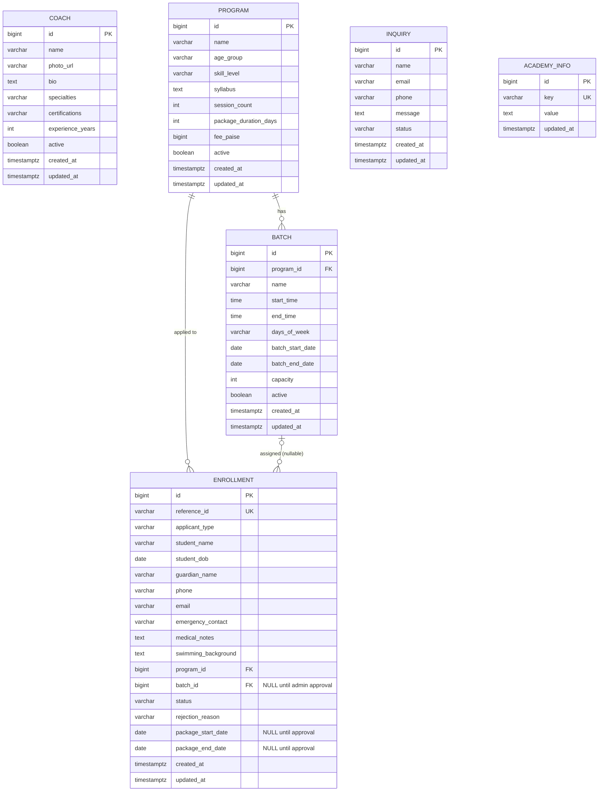
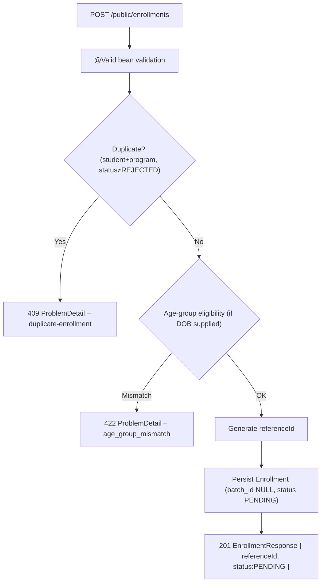
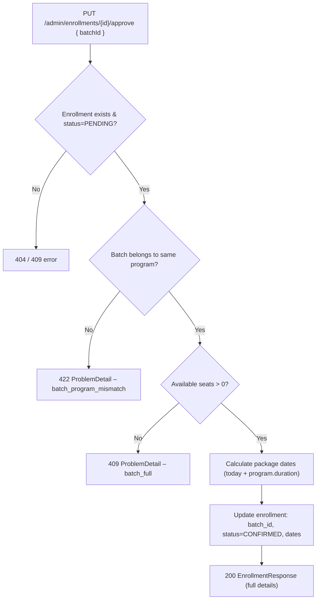
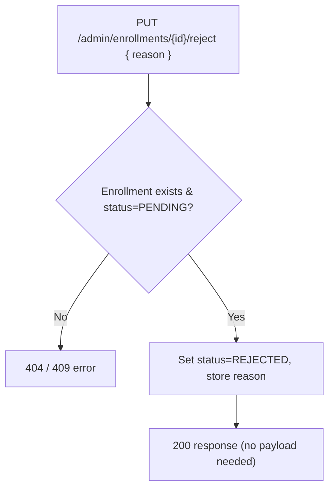
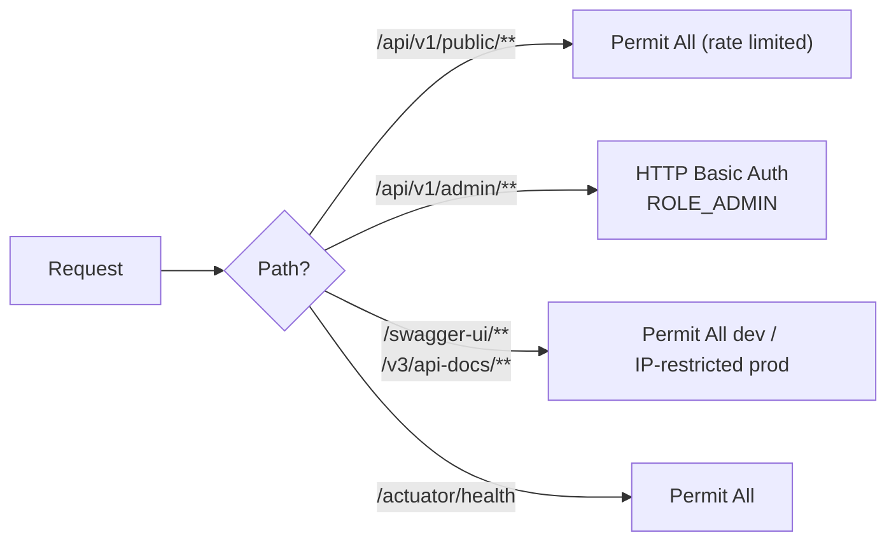
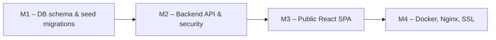

# Phase 1 – Backend‑Heavy Implementation Plan (Public Site Only)

> **Status:** 🟡 Awaiting User Approval · Created: 2026‑11‑17

---

## Goal Description

Build a **backend‑centric** platform for the swim academy that exposes:
1. A **public React SPA** with six static pages (Home, About, Coaches, Programs, Enroll, Contact).
2. **Admin‑only REST APIs** (secured via HTTP Basic Auth) for catalog management and enrollment review.
3. An **admin‑gated enrollment workflow** where a visitor selects a program, submits a single‑step form, and receives a `PENDING` status. An admin later reviews, contacts the applicant offline, and **approves (assigns a batch) or rejects** the application.
4. **Duplicate enrollment blocking** – a new submission is rejected if a non‑rejected record with the same `student_name` and `program_id` already exists.
5. **Seed data** for programs, batches, coaches, and academy info so the public site works out‑of‑the‑box.
6. **Free‑iframe Google Maps** on the Contact page and **coach photo URLs** stored in the DB.

---

## User Review Required

> [!IMPORTANT]
> **Duplicate enrollment block** – The backend will return `409 Conflict` with a `duplicate-enrollment` problem detail if a pending or confirmed enrollment already exists for the same student‑name and program. This prevents accidental double submissions.

> [!IMPORTANT]
> **Domain & SSL** – A real domain (e.g., `swimacademy.in`) is required for Nginx CORS whitelist and SSL certificates. Development can use `localhost`.

> [!IMPORTANT]
> **Currency storage** – Fees are stored as **paise** (`BIGINT`). Confirm this is acceptable.

> [!WARNING]
> **Admin credentials** – A single admin user is defined via env vars (`ADMIN_USERNAME`, `ADMIN_PASSWORD`). Change the defaults before production.

---

## Open Questions

> [!IMPORTANT]
> **1. Academy branding** – Official name, tagline, and primary brand colors for Tailwind config and hero banner.

> [!IMPORTANT]
> **2. Re‑application policy** – After a rejection, should the applicant be allowed to submit a new enrollment for the same program? (Current plan permits a new submission if the prior record is `REJECTED`.)

---

## Proposed Changes

### Project Directory Layout

```
f:\New folder\Naman\Swim\
├── backend/                     ← Spring Boot Maven project
│   ├── src/main/java/com/swimacademy/
│   │   ├── config/               ← Security, CORS, OpenAPI, Rate‑Limiting beans
│   │   ├── controller/
│   │   │   ├── public_/          ← PublicCoachController, PublicProgramController,
│   │   │   │                     PublicEnrollmentController, PublicInquiryController
│   │   │   └── admin/            ← Admin*Controller (CRUD + approve/reject)
│   │   ├── dto/
│   │   │   ├── request/          ← EnrollmentRequest, ApproveRequest, RejectRequest, InquiryRequest
│   │   │   └── response/         ← EnrollmentResponse, InquiryResponse, etc.
│   │   ├── entity/               ← Coach, Program, Batch, Enrollment, Inquiry, AcademyInfo
│   │   ├── exception/            ← GlobalExceptionHandler + custom exceptions
│   │   ├── mapper/               ← MapStruct mappers
│   │   ├── repository/           ← Spring Data JPA repositories
│   │   └── service/              ← Business logic (EnrollmentService, AdminService)
│   ├── src/main/resources/
│   │   ├── db/migration/         ← Flyway V1–V5 scripts (including seed data)
│   │   └── application.yml
│   ├── Dockerfile
│   └── pom.xml
│
├── frontend/                    ← React + Vite + TypeScript (static public site)
│   ├── src/
│   │   ├── api/                 ← Axios instance + TanStack Query hooks
│   │   ├── components/          ← Navbar, Footer, Card, MapIframe
│   │   ├── pages/               ← Home, About, Coaches, Programs, Enroll, Contact
│   │   ├── schemas/             ← Zod schemas for enrollment & inquiry
│   │   ├── types/               ← TypeScript interfaces mirroring DTOs
│   │   └── App.tsx
│   ├── Dockerfile
│   └── vite.config.ts
│
├── nginx/
│   ├── nginx.conf                ← SPA fallback, /api/** proxy, SSL
│   └── ssl/                     ← Certbot‑generated certs (to be added on VPS)
│
└── docker-compose.yml           ← postgres, backend, nginx (frontend served by nginx)
```

---

### Database Schema (PostgreSQL 17/18)



#### Important Constraints & Indexes
- **Reference ID**: `SWM-YYYYMMDD-{UUID8}` (unique, human‑readable).
- **Status** CHECK (`PENDING`,`CONFIRMED`,`REJECTED`).
- **Duplicate block**: unique index on `(student_name, program_id, status)` where `status <> 'REJECTED'`.
- **Fee** stored as `BIGINT` paise.
- **Batch ID** nullable until admin approval.
- **Applicant type** CHECK (`PARENT_CHILD`,`ADULT_SELF`).

#### Flyway Seed Migrations (V2–V5)
- **V2** – 8 sample programs covering all age groups/skill levels.
- **V3** – 2–3 batches per program (different days/times, capacity 12‑20).
- **V4** – 4 coaches with placeholder photo URLs (e.g., `https://cdn.example.com/coaches/jane.jpg`).
- **V5** – AcademyInfo entries: address, phone, WhatsApp link, pool specs, **free‑iframe map URL**.

---

### API Contract

#### Public Endpoints (`/api/v1/public/`)
| Method | Path | Description |
|---|---|---|
| `GET` | `/coaches` | List active coaches |
| `GET` | `/programs` | Filterable list (ageGroup, skillLevel) |
| `GET` | `/programs/{id}` | Program details + informational batch schedule |
| `GET` | `/academy-info` | Key‑value metadata (address, hours, map iframe) |
| `POST` | `/enrollments` | Submit enrollment → returns `{ referenceId, status: PENDING }` |
| `GET` | `/enrollments/{referenceId}` | **Optional** – returns status only (no rejection reason) |
| `POST` | `/inquiries` | Submit Contact‑Us form |

> **No batch‑availability endpoint** – batch data is displayed read‑only on the Programs page.

#### Admin Endpoints (`/api/v1/admin/` – HTTP Basic Auth)
| Method | Path | Description |
|---|---|---|
| `GET` | `/enrollments` | Paginated list, filterable by `status`, `programId` |
| `GET` | `/enrollments/{id}` | Full enrollment record |
| `PUT` | `/enrollments/{id}/approve` | Body `{ "batchId": <long> }` – assigns batch, calculates dates, sets status `CONFIRMED` |
| `PUT` | `/enrollments/{id}/reject` | Body `{ "reason": "..." }` – sets status `REJECTED` and stores `rejection_reason` |
| CRUD (GET/POST/PUT/DELETE) | `/coaches`, `/programs`, `/batches` | Catalog management |
| `PUT` | `/academy-info/{key}` | Update a single info entry |

All admin routes are **rate‑limit exempt** but protected by Basic Auth.

---

### Business Logic

#### Enrollment Submission (Public)


#### Admin Approval


#### Admin Rejection


---

### Global Exception Handling (RFC 7807)
All errors return the following JSON shape:
```json
{
  "type": "https://swimacademy.in/errors/<slug>",
  "title": "<Human readable title>",
  "status": <http status>,
  "detail": "<explanation>",
  "instance": "<request path>"
}
```
Custom `slug`s include:
- `duplicate-enrollment`
- `batch-full`
- `batch-program-mismatch`
- `invalid-status-transition`
- `age-group-mismatch`
- `validation-failed`

---

### Rate Limiting (Bucket4j – in‑memory)
| Endpoint | Limit |
|---|---|
| `POST /public/enrollments` | 5 per 10 min per IP |
| `POST /public/inquiries` | 10 per 10 min per IP |
| `GET /public/**` | 60 per minute per IP |
| Admin routes | No rate limit (protected) |

---

### Spring Security Configuration


---

### Frontend (Public SPA Only)
- **React 19 + Vite + TypeScript** – built once and served statically by Nginx.
- **Tailwind CSS** for styling.
- **Enroll page**: single‑step form (applicant type → personal details → program selection → submit).
- **Zod** validates phone, required fields, and optional DOB‑age‑group consistency (client‑side hint).
- **MapIframe component** renders the free‑iframe URL from `academy-info`.
- **CoachCard** displays the stored photo URL.
- No authentication flow; admin actions are performed via Swagger UI or external tools.

---

## Verification Plan

### Automated Tests
```bash
# Backend unit + integration (H2 + Testcontainers PostgreSQL)
cd backend
mvn test
mvn verify -Pintegration

# Frontend unit tests (Vitest) – ensure form validation & API types compile
cd ../frontend
npm run test
```
**Key test scenarios**
- Duplicate enrollment → 409 `duplicate-enrollment`.
- Age‑group mismatch → 422 `age-group-mismatch`.
- Admin approve assigns batch, calculates dates, status becomes `CONFIRMED`.
- Admin reject stores reason, status becomes `REJECTED`.
- Public `GET /programs/{id}` returns batch schedule (no enrollment link).
- Rate limiting returns 429 after exceeding limits.

### Manual Verification Checklist
- **Swagger UI** reachable at `/swagger-ui.html` (admin only). Verify CRUD, approve, reject flows.
- **Public site** loads all pages, shows seeded data, and Enroll form submits, displaying the reference ID.
- **Map iframe** renders on Contact page without API key.
- **Coach photos** load from URL strings.
- **Docker Compose** (`docker-compose up`) starts PostgreSQL, backend, and Nginx; SPA served at `http://localhost`.
- **SSL** works on the provided domain.

---

## Milestone Timeline


---

## Phase 2 Hooks (for later)
- `reference_id` becomes the login key for the future student portal.
- `rejection_reason` stored for later display to the applicant.
- Admin APIs already ready for an admin UI.
- `batch_id` enables attendance tracking.

---

*Please answer the two open questions (branding & re‑application policy) so I can proceed with scaffolding.*